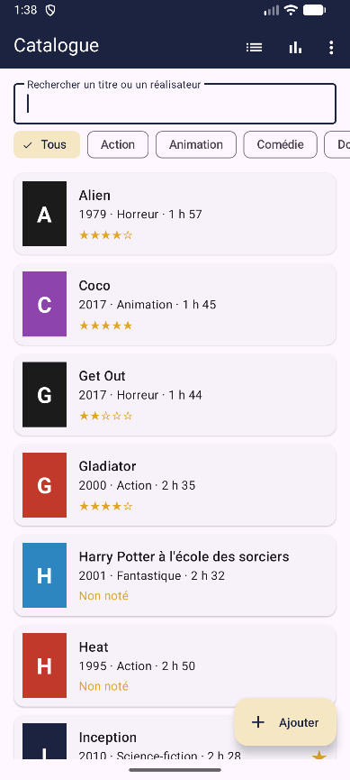
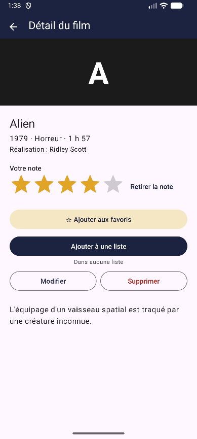
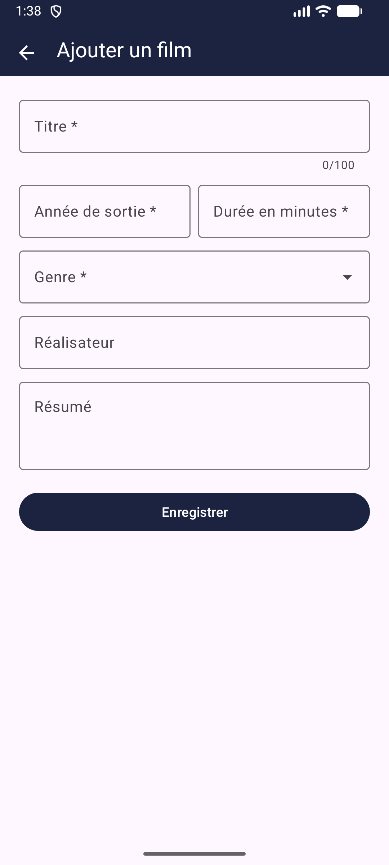
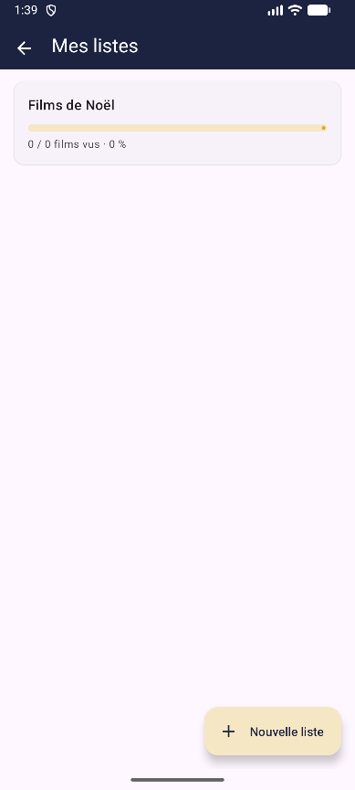
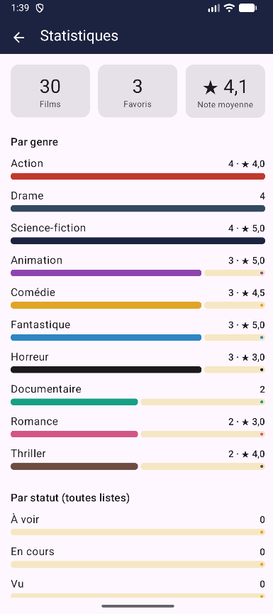
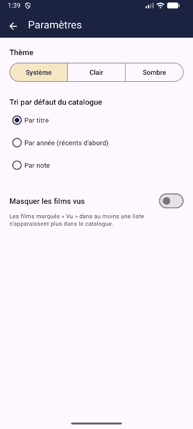
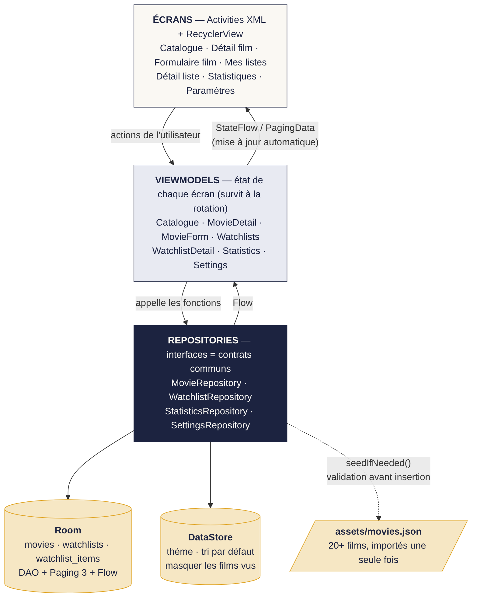
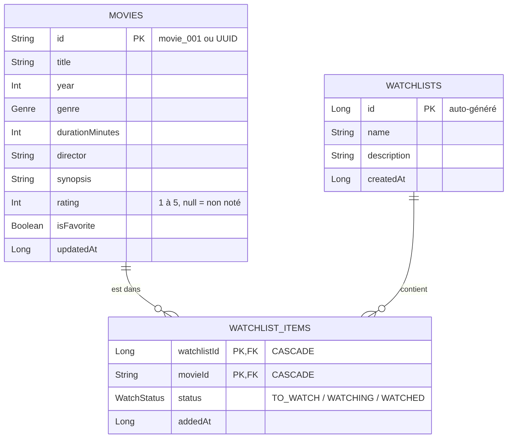

# 🎬 WatchList — Gestionnaire de films et de watchlists

Projet final **ESTIAM E5 — Mobile Apps Development** · Android natif · Kotlin · Android Studio

WatchList permet de gérer une collection de films, de les noter, de les ranger dans des
listes personnelles (« Films de Noël », « À voir avec Léa »…) et de suivre ce qui a été vu.
L'application fonctionne entièrement hors ligne : toutes les données sont stockées sur le téléphone.

---

## Sommaire
1. [Captures d'écran](#1-captures-décran)
2. [Fonctionnalités](#2-fonctionnalités)
3. [Architecture](#3-architecture)
4. [Base de données Room](#4-base-de-données-room)
5. [Import JSON et préférences DataStore](#5-import-json-et-préférences-datastore)
6. [Installation et lancement](#6-installation-et-lancement)
7. [Tests](#7-tests)
8. [Débogage](#8-débogage)
9. [Organisation Git et contributions](#9-organisation-git-et-contributions)
10. [Structure du projet](#10-structure-du-projet)

---

## 1. Captures d'écran

| Catalogue | Détail d'un film | Formulaire |
|:---:|:---:|:---:|
|  |  |  |

| Mes listes | Détail d'une liste | Statistiques | Paramètres |
|:---:|:---:|:---:|:---:|
|  |  |  |  |

---

## 2. Fonctionnalités

### Les 7 écrans

| # | Écran | Ce que l'on peut faire |
|---|---|---|
| 1 | **Catalogue** (écran de démarrage) | Liste paginée des films (Paging 3) · recherche par titre ou réalisateur · filtre par genre · « favoris uniquement » · tri par titre, année ou note · états chargement / liste vide / erreur avec « Réessayer » |
| 2 | **Détail d'un film** | Note de 1 à 5 étoiles · favori · ajout à une ou plusieurs listes · modification · suppression avec confirmation |
| 3 | **Formulaire de film** | Ajout et modification, avec une erreur affichée sous chaque champ invalide |
| 4 | **Mes listes** | Toutes les listes avec leur barre de progression · création d'une liste |
| 5 | **Détail d'une liste** | Films de la liste et leur statut (À voir / En cours / Vu) · retrait d'un film · modification et suppression de la liste |
| 6 | **Statistiques** | Nombre de films, de favoris, note moyenne · répartition par genre et par statut |
| 7 | **Paramètres** | Thème, tri par défaut du catalogue, masquage des films vus |

### Deux CRUD complets
- **Films** : créer (formulaire), lire (catalogue + détail), modifier (formulaire), supprimer (détail).
- **Listes** : créer (boîte de dialogue), lire (Mes listes + détail), modifier (renommer), supprimer — plus l'ajout / retrait de films et le changement de statut.

### Deux fonctionnalités métier
1. **Statistiques de la collection** : calculées par des requêtes Room (`COUNT`, `AVG`, `GROUP BY`) et recalculées automatiquement à chaque modification.
2. **Progression des listes** : pourcentage de films vus dans chaque liste (« 4 / 10 films vus · 40 % »), mis à jour dès qu'un statut change.

### Qualité de l'interface
- Contrôles de saisie sur les deux formulaires (film et liste).
- Messages pour les listes vides et les erreurs.
- Bon comportement à la rotation de l'écran (l'état est conservé par les ViewModels).
- Thème Material 3 « salle de cinéma » (bleu nuit et or), en clair et en sombre.
- Toutes les données sont conservées après fermeture et relance de l'application.

---

## 3. Architecture

L'application suit l'architecture **MVVM + Repository** recommandée par Google.



| Couche | Rôle | Exemple |
|---|---|---|
| **Écrans** (Activities XML + ViewBinding) | Affichent l'état et transmettent les actions de l'utilisateur | `CatalogueActivity` |
| **ViewModels** | Gardent l'état de chaque écran (survivent à la rotation) et lancent les actions | `CatalogueViewModel` garde la recherche, le filtre et le tri |
| **Repositories** (interfaces) | Contrat unique d'accès aux données | `MovieRepository.saveMovie(movie)` |
| **Sources de données** | Room (films, listes), DataStore (préférences), JSON (import initial) | table `movies`, clé `pref_theme` |

**Règle principale : un écran dépend du contrat du Repository, jamais d'une classe de base de données.**
Les interfaces sont dans `data/Repositories.kt`. Leurs implémentations (`RoomMovieRepository`,
`DataStoreSettingsRepository`…) sont créées une seule fois dans `WatchListApplication` et partagées par tous les écrans.

### Flux de données réactif
1. L'utilisateur modifie un film → le ViewModel appelle `movieRepository.saveMovie()`.
2. Room écrit dans la table `movies`, hors du thread principal (fonction `suspend`).
3. Room invalide automatiquement les requêtes qui lisent cette table.
4. Le catalogue (**Paging 3**), la fiche du film et les statistiques (**Flow**) se mettent à jour **sans rafraîchissement manuel**.

### Technologies

| Domaine | Choix |
|---|---|
| Langage | Kotlin 2.2 · coroutines et Flow |
| Interface | Vues XML + ViewBinding · Material Components 3 · RecyclerView |
| Architecture | ViewModel + StateFlow · Repository |
| Base de données | Room 2.7 (DAO, relations, clés étrangères, transactions) |
| Pagination | Paging 3.3 (`PagingSource` généré par Room) |
| Préférences | Preferences DataStore 1.1 |
| Tests | JUnit 4 · Espresso 3.7 |
| Cible | minSdk 26 (Android 8) · targetSdk 35 · AGP 8.11 · Gradle 8.13 |

Plus de détails : [docs/ARCHITECTURE.md](docs/ARCHITECTURE.md).

---

## 4. Base de données Room



| Entité | Table | Rôle |
|---|---|---|
| `Movie` | `movies` | Un film. Clé texte stable (`movie_001` ou UUID) : évite les doublons à l'import |
| `Watchlist` | `watchlists` | Une liste créée par l'utilisateur. Clé numérique auto-générée |
| `WatchlistItem` | `watchlist_items` | **Table de liaison plusieurs-à-plusieurs** : un film dans une liste, avec son statut de visionnage |

- Clé primaire composée `(watchlistId, movieId)` : un film n'apparaît qu'une fois par liste.
- Clés étrangères en **`CASCADE`** : supprimer un film ou une liste supprime automatiquement les lignes liées, les données restent cohérentes.
- Jointures (`JOIN`, `LEFT JOIN`) pour afficher les films d'une liste et calculer la progression.

---

## 5. Import JSON et préférences DataStore

### Import JSON (`app/src/main/assets/movies.json`)
- **30 films valides** + 3 entrées volontairement invalides (titre vide, durée négative, doublon) pour démontrer la validation.
- Chaque film est **validé avant insertion** (`MovieJsonParser` + `Movie.validate()`, les mêmes règles que le formulaire).
- Import réalisé **une seule fois**, au premier lancement : un marqueur est enregistré dans la table `app_meta`, dans la même transaction que les films.
- **Ni doublons, ni écrasement** des modifications de l'utilisateur (`OnConflictStrategy.IGNORE`).
- Résultat visible dans Logcat (tag `WatchListSeed`) : `Import JSON : 30 films valides, 3 rejetés`.

### Préférences (`DataStoreSettingsRepository`)

| Clé | Valeurs | Effet visible |
|---|---|---|
| `pref_theme` | Système / Clair / Sombre | Thème de toute l'application, appliqué immédiatement |
| `pref_default_sort` | Titre / Année / Note | Ordre du catalogue (aussi enregistré depuis le menu ⋮ du catalogue) |
| `pref_hide_watched` | Oui / Non | Masque du catalogue les films marqués « Vu » dans une liste |

Les préférences sont observées sous forme de **Flow** : l'interface se met à jour dès qu'elles changent,
et elles sont conservées après relance.

---

## 6. Installation et lancement

### Prérequis
- Android Studio (version récente) avec un émulateur ou un téléphone Android 8.0 (API 26) minimum.
- JDK 17 ou 21 : *Settings → Build, Execution, Deployment → Build Tools → Gradle → Gradle JDK*.

### Étapes
1. Cloner le dépôt :
   ```bash
   git clone https://github.com/morganautin/watchlist-android.git
   ```
2. Dans Android Studio : **File → Open…** et choisir le dossier `watchlist-android`.
3. Attendre la fin de la synchronisation Gradle (ou cliquer sur **Sync Project with Gradle Files**).
4. Choisir un émulateur, puis **Run ▶** (configuration `app`).

Au premier lancement, les 30 films du fichier JSON sont importés automatiquement.

---

## 7. Tests

**17 tests automatisés** : 14 tests JUnit et 3 tests Espresso.

### Lancer les tests
| Type | Commande ou action |
|---|---|
| JUnit (sur l'ordinateur) | `./gradlew testDebugUnitTest` (Windows : `.\gradlew.bat testDebugUnitTest`) — ou clic droit sur le dossier `test` → *Run 'Tests in…'* |
| Espresso (sur émulateur) | Émulateur démarré, puis clic droit sur le dossier `androidTest` → *Run 'Tests in…'* — ou `./gradlew connectedDebugAndroidTest` (désinstalle l'application à la fin) |

### Tests JUnit — `app/src/test/`
| Fichier | Tests | Ce qui est vérifié |
|---|:---:|---|
| `ModelValidationTest` | 6 | Validation d'un film et d'une liste, calcul de la progression (y compris liste vide) |
| `MovieJsonParserTest` | 3 | Fichier JSON livré (30 valides, 3 rejetés), entrées invalides et doublons, valeurs par défaut |
| `MovieFormLogicTest` | 2 | Saisie du formulaire → film (nombres mal tapés, conservation de l'id en modification) |
| `SettingsMappingTest` | 3 | Lecture des préférences DataStore (fichier vide, valeurs enregistrées, valeurs inconnues) |

### Tests Espresso — `app/src/androidTest/`
| Fichier | Scénario |
|---|---|
| `MovieFormValidationTest` | Formulaire vide → une erreur sous chaque champ obligatoire, le formulaire reste ouvert |
| `MovieCrudFlowTest` | Ajouter un film → le retrouver avec la recherche → ouvrir sa fiche → le supprimer |
| `WatchlistCrudFlowTest` | Nom de liste vide refusé → créer une liste → l'ouvrir → la supprimer |

Les tests Espresso suppriment ce qu'ils créent : ils ne laissent aucune donnée dans l'application.

---

## 8. Débogage

Deux bugs réels ont été analysés et corrigés avec les outils d'Android Studio
(détails, causes et captures dans [docs/DEBUGGING.md](docs/DEBUGGING.md)) :

| Bug | Outils | Cause | Solution |
|---|---|---|---|
| « Ajouter à une liste » ignorait les listes existantes | Point d'arrêt + inspection des variables (`lists` vide) + Logcat | `StateFlow` en `WhileSubscribed` jamais démarré, car l'écran lisait `.value` sans observer le flux | `SharingStarted.Eagerly` |
| Plantage du catalogue après la suppression d'un film | Test Espresso + pile d'appels dans Logcat (`IndexOutOfBoundsException: Inconsistency detected`) | Collecte Paging arrêtée puis relancée par `repeatOnLifecycle` pendant que Room mettait les données à jour | Collecte de la `PagingData` en dehors de `repeatOnLifecycle` |

Autres outils utilisés : Logcat (tag `WatchListSeed` pour l'import JSON), Database Inspector pour consulter les tables Room en direct.

---

## 9. Organisation Git et contributions

### Méthode de travail
- `main` contient la version stable et n'est modifiée que par **Pull Request**.
- Une branche par fonctionnalité, fusionnée après vérification (compilation, tests, essai sur émulateur).
- Messages de commit en français, qui décrivent le changement.

### Historique des Pull Requests
| PR | Branche | Contenu |
|:---:|---|---|
| #1 | `feature/conception` | Entités Room, contrats des Repositories, schémas d'architecture, premiers tests |
| #2 | `feature/room-database` | DAO, Repositories Room, import JSON, tests du parser |
| #3 | `feature/catalogue-ecrans` | Catalogue (Paging 3, recherche, filtres, tri), détail et formulaire de film |
| #4 | `feature/listes-statistiques` | Mes listes, détail d'une liste, statistiques, ajout d'un film à une liste |
| #5 | `feature/preferences` | Préférences DataStore et écran Paramètres |
| #6 | `feature/tests-debogage` | Tests Espresso et documentation du débogage |
| #7 | `feature/readme-final` | Corrections issues du débogage, captures et README final |

### Contributions

| Membre | Rôle |
|---|---|
| **morganautin** | Projet réalisé seul : conception, base de données Room, écrans, préférences, tests, débogage et documentation |

---

## 10. Structure du projet

```
app/src/
├── main/
│   ├── assets/movies.json              ← 30 films importés au premier lancement
│   ├── java/fr/estiam/watchlist/
│   │   ├── WatchListApplication.kt     ← crée la base, les Repositories et applique le thème
│   │   ├── model/                      ← entités Room et objets métier
│   │   │   ├── Movie.kt                   (+ règles de validation)
│   │   │   ├── Watchlist.kt               (Watchlist, WatchlistItem, WatchlistSummary…)
│   │   │   ├── CatalogueQuery.kt, Statistics.kt, UserSettings.kt
│   │   ├── data/
│   │   │   ├── Repositories.kt         ← contrats (interfaces) des 4 Repositories
│   │   │   ├── local/                  ← Room : base, DAO, Repositories, parser JSON
│   │   │   └── prefs/                  ← DataStore : préférences
│   │   └── ui/
│   │       ├── catalogue/              ← écran 1
│   │       ├── movie/                  ← écrans 2 et 3
│   │       ├── watchlist/              ← écrans 4 et 5
│   │       ├── stats/                  ← écran 6
│   │       ├── settings/               ← écran 7
│   │       └── common/                 ← fonctions et boîte de dialogue partagées
│   └── res/                            ← layouts XML, textes (strings.xml), thèmes clair / sombre
├── test/                               ← 14 tests JUnit
└── androidTest/                        ← 3 tests Espresso
docs/
├── ARCHITECTURE.md                     ← architecture détaillée et schémas
├── DEBUGGING.md                        ← tests et bugs documentés
├── CHECKLIST.md                        ← suivi des exigences du projet
├── debug/                              ← captures du débogage
└── screenshots/                        ← captures de l'application
```
