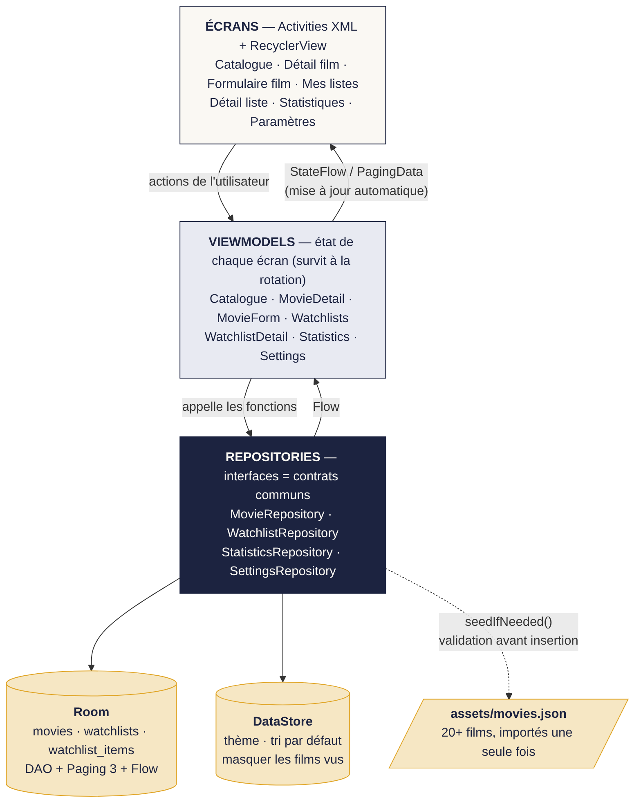
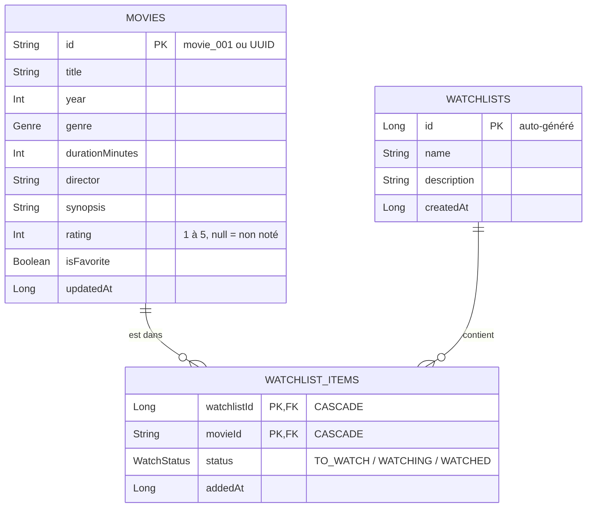

# Architecture de WatchList

## 1. Les couches (MVVM + Repository)

Chaque couche ne parle qu'à la couche juste en dessous :

| Couche | Rôle | Exemple |
|---|---|---|
| **Écrans** (Activities XML) | Affichent l'état et transmettent les clics | `CatalogueActivity` affiche la liste paginée |
| **ViewModels** | Gardent l'état de l'écran (survit à la rotation) et lancent les actions | `CatalogueViewModel` garde la recherche, le filtre et le tri |
| **Repositories** (interfaces) | Contrat unique d'accès aux données | `MovieRepository.saveMovie(movie)` |
| **Sources de données** | Room (films, listes), DataStore (préférences), JSON (import initial) | table `movies`, clé `pref_theme` |

Règle d'équipe : **un écran dépend du contrat du Repository, jamais d'une classe Room.**
Les contrats sont dans `data/Repositories.kt` et les modèles dans `model/`.

## 2. La base de données Room (3 entités reliées)

- **Movie** — un film du catalogue. Clé texte stable (`movie_001` ou UUID) : évite les doublons à l'import JSON.
- **Watchlist** — une liste créée par l'utilisateur. Clé numérique auto-générée.
- **WatchlistItem** — table de liaison *plusieurs-à-plusieurs* entre une liste et un film, avec le **statut** de visionnage (`TO_WATCH`, `WATCHING`, `WATCHED`).
  - Clé primaire composée `(watchlistId, movieId)` : un film n'apparaît qu'une fois par liste.
  - Clés étrangères en `CASCADE` : supprimer un film ou une liste supprime automatiquement les lignes liées → les données restent cohérentes.

## 3. Flux de données réactif

1. L'utilisateur modifie un film → le ViewModel appelle `movieRepository.saveMovie()`.
2. Room écrit dans la table `movies` (hors du thread principal).
3. Room invalide automatiquement les requêtes qui lisent `movies` :
   le catalogue (Paging 3), le détail (Flow) et les statistiques (Flow) se recalculent.
4. Les écrans reçoivent les nouvelles valeurs **sans rafraîchissement manuel**.

## 4. Fonctionnalités métier

1. **Statistiques** (`StatisticsRepository`) : nombre de films et note moyenne par genre, nombre de films par statut, note moyenne globale.
2. **Progression des listes** (`WatchlistSummary.progressPercent`) : pourcentage de films vus dans chaque liste, recalculé dès qu'un statut change.

## 5. Préférences (DataStore)

| Clé | Valeurs | Effet visible |
|---|---|---|
| `pref_theme` | SYSTEM / LIGHT / DARK | Thème clair ou sombre de toute l'app |
| `pref_default_sort` | TITLE / YEAR / RATING | Ordre du catalogue au lancement |
| `pref_hide_watched` | true / false | Masque du catalogue les films marqués « vus » |
