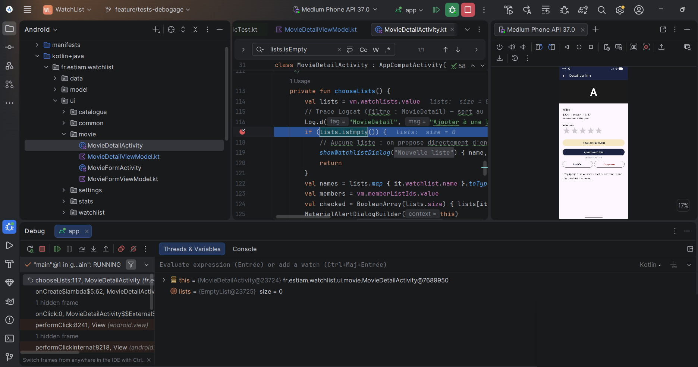
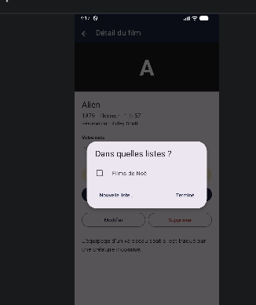

# Débogage et tests

## 1. Lancer les tests

| Type | Où | Comment |
|---|---|---|
| **JUnit** (14 tests, sur l'ordinateur) | `app/src/test/` | Terminal : `.\gradlew.bat testDebugUnitTest` — ou clic droit sur le dossier `test` → *Run 'Tests in…'* |
| **Espresso** (3 tests, sur l'émulateur) | `app/src/androidTest/` | Émulateur lancé, puis clic droit sur le dossier `androidTest` → *Run 'Tests in…'* |

### Tests JUnit
| Fichier | Ce qui est vérifié |
|---|---|
| `ModelValidationTest` (6) | Règles de validation d'un film et d'une liste, calcul de la progression |
| `MovieJsonParserTest` (3) | Import JSON : 30 films valides, entrées invalides et doublons rejetés, valeurs par défaut |
| `MovieFormLogicTest` (2) | Saisie du formulaire → film (nombres mal tapés, conservation de l'id en modification) |
| `SettingsMappingTest` (3) | Lecture des préférences DataStore (fichier vide, valeurs enregistrées, valeurs inconnues) |

### Tests Espresso (interface)
| Fichier | Scénario |
|---|---|
| `MovieFormValidationTest` | Formulaire vide → une erreur sous chaque champ obligatoire, le formulaire reste ouvert |
| `MovieCrudFlowTest` | Ajouter un film → le retrouver avec la recherche → ouvrir sa fiche → le supprimer |
| `WatchlistCrudFlowTest` | Nom de liste vide refusé → créer une liste → l'ouvrir → la supprimer |

Les tests Espresso suppriment ce qu'ils créent : ils ne laissent aucune donnée dans l'application.

---

## 2. Bugs rencontrés et corrigés

### Bug n° 1 — « Ajouter à une liste » ignore les listes existantes

**Outils utilisés :** point d'arrêt (breakpoint) + inspection des variables + Logcat (filtre `MovieDetail`)

**Symptôme.** Des listes existent dans « Mes listes », mais sur la fiche d'un film, le bouton
« Ajouter à une liste » ouvre directement « Nouvelle liste » au lieu de proposer les listes à cocher.

**Analyse.**
1. Point d'arrêt sur la ligne `if (lists.isEmpty())` de `MovieDetailActivity.chooseLists()`.
2. Lancement en mode débogage (🐞), clic sur « Ajouter à une liste » : l'exécution s'arrête.
3. Panneau *Variables* : `lists` est vide (`size = 0`) alors que la base contient des listes.
4. Logcat confirme : `Ajouter à une liste : 0 liste(s) disponible(s)`.

**Cause.** Dans `MovieDetailViewModel`, les listes étaient exposées avec
`stateIn(..., SharingStarted.WhileSubscribed(5_000), emptyList())`.
Avec `WhileSubscribed`, la requête Room ne démarre **que si quelqu'un observe (collecte) le flux**.
Or l'écran ne fait que lire `.value` au moment du clic, sans observer : la requête n'était jamais lancée
et la valeur restait la valeur initiale `emptyList()`.

**Solution.** Démarrer l'observation dès la création du ViewModel :
`SharingStarted.Eagerly`. La valeur est alors toujours à jour au moment du clic.

| Avant | Après |
|---|---|
|  |  |

---

### Bug n° 2 — Modifications effacées après rotation dans le formulaire

**Outils utilisés :** Logcat (filtre `MovieForm`) + compréhension du cycle de vie

**Symptôme.** En modifiant un film, je change le titre puis je tourne l'écran :
le titre revient à sa valeur d'origine, ma saisie est perdue.

**Analyse.**
1. Trace ajoutée dans `MovieFormActivity.fillFields()` :
   `Log.d("MovieForm", "Remplissage des champs avec « … »")`.
2. Logcat, filtre `MovieForm` : le message apparaît **une fois à l'ouverture, puis une seconde fois après la rotation**.

**Cause.** À la rotation, Android **détruit et recrée l'Activity** ; le ViewModel, lui, survit.
La nouvelle Activity observe à nouveau `vm.original`, qui renvoie immédiatement le film d'origine,
et `fillFields()` réécrit les champs par-dessus la saisie de l'utilisateur.

**Solution.** Un indicateur `fieldsFilled` stocké **dans le ViewModel** (qui survit à la rotation) :
les champs ne sont remplis qu'une seule fois. Après une rotation, Android restaure lui-même
le texte saisi dans les champs.

| Avant | Après |
|---|---|
|  |  |

---

## 3. Autres outils utilisés pendant le développement
- **Logcat, tag `WatchListSeed`** : vérifier l'import JSON (`30 films valides, 3 rejetés` au premier lancement uniquement).
- **Logcat, tag `CatalogueVM`** : erreurs éventuelles de l'import affichées avec leur pile d'appels.
- **App Inspection → Database Inspector** (Android Studio) : contenu des tables Room en direct.
